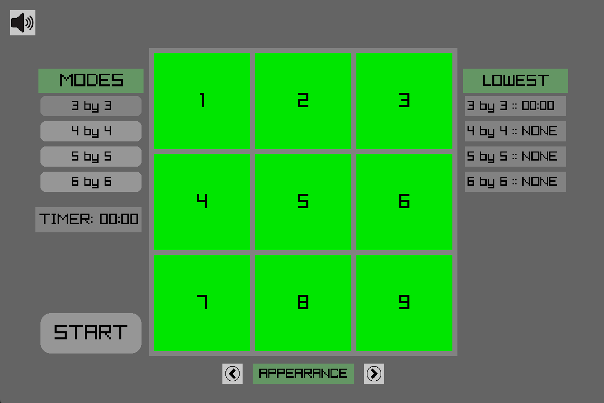
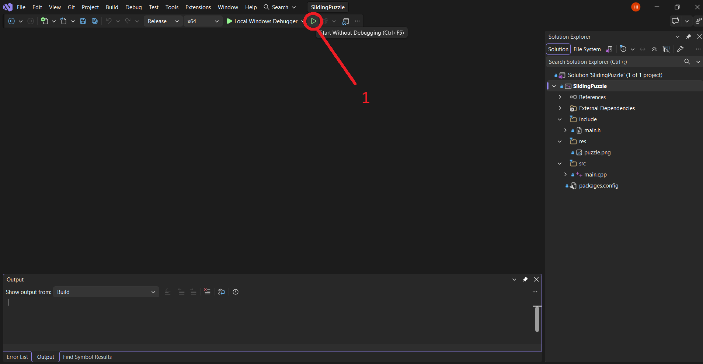
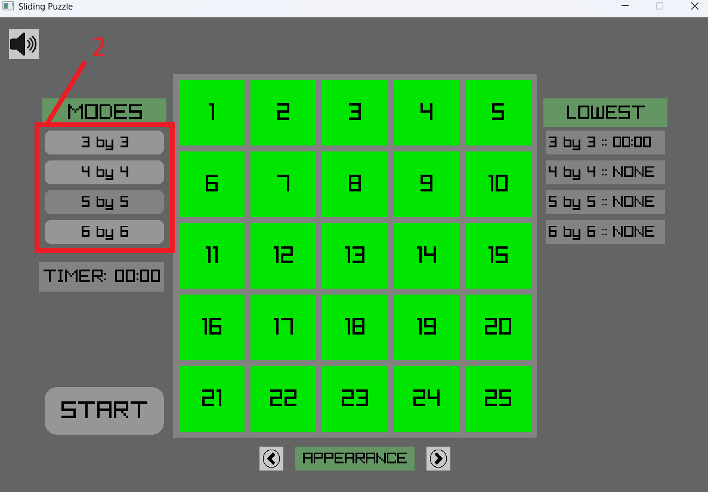
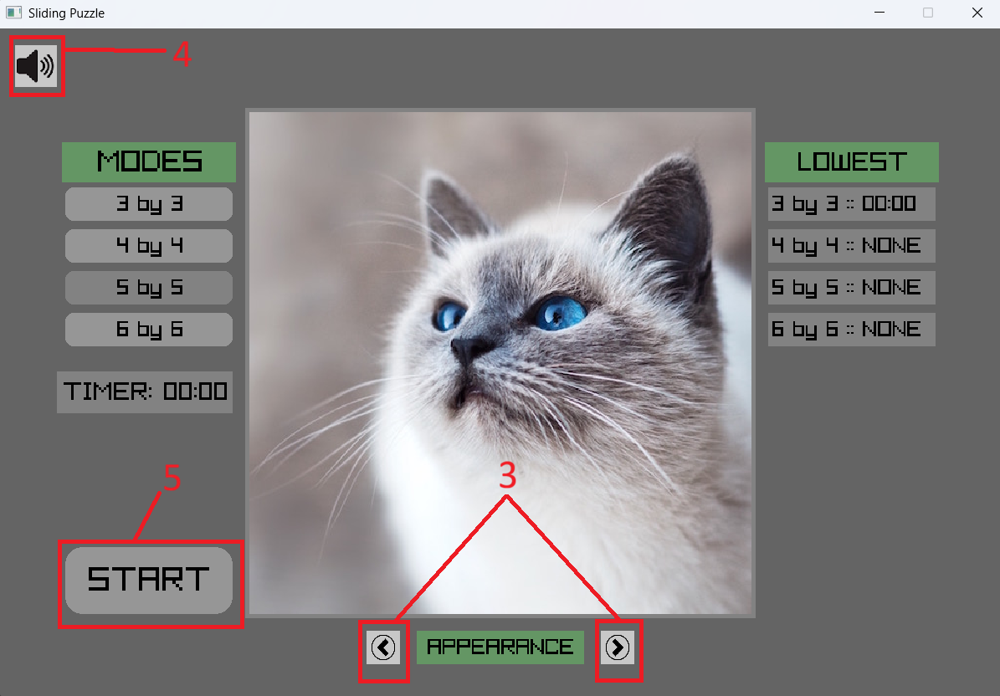
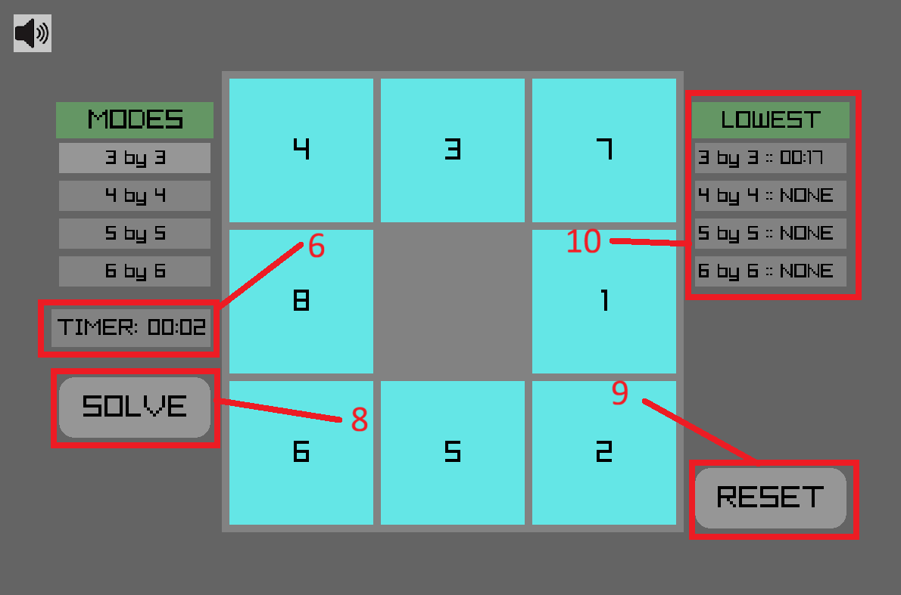
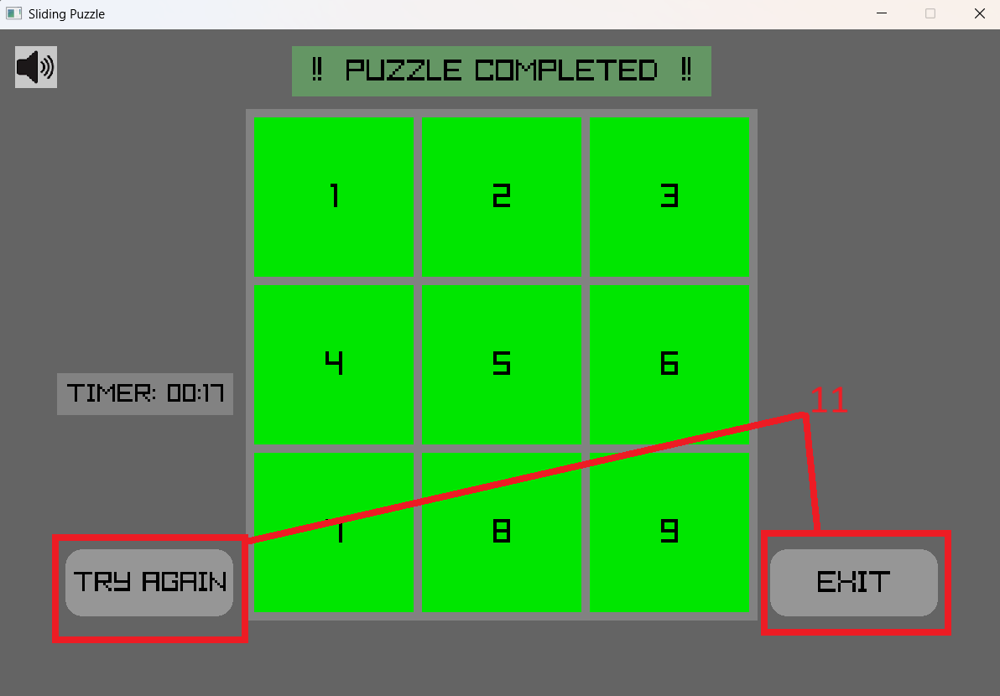

# sliding-puzzle-game

The Sliding Puzzle game is a basic one, in which you move around tiles on a grid to either create an image or to match a specific order of numbers.

## Table of Contents

- [Purpose](#purpose)
- [Install](#install)
- [Usage](#usage)
- [Maintainers](#maintainers)
- [License](#license)

## Purpose
This game was created as a semester project for the course of Programming Fundamentals in FAST NUCES.
It was built by three people: Myself and the two other contributors who have also been mentioned below.

## Install
<!-- 1. First download the project files.
2. Create a Visual Studio Empty Project
3. Add the project files to the VS project. Then, right click the Project in the Solution Explorer -> Add -> Existing item -> Select the main.cpp file in the src folder
4. Add the Raylib graphics library to the project using the nuget Package Manager. Make sure that the name of the library is "raylib" and not anything else.
5. The game is ready to be run. Set the build option to Release for the best experience. -->

1. Download the project files.
2. Open the Solution folder.
3. Double click on the Solution file (.sln) to open it.
4. The game should be in a runnable state
## Usage
1. Click on the green triangle in the project when it has been opened in Visual Studio to run it.

2. Choose your mode by selecting one of the buttons on the left of the screen.

3. Change the appearance by using the arrow keys in the bottom center.
4. The music can be toggles by using the button in the top left corner.
5. Click Start to begin the game.

6. The timer shows the number of seconds elapsed since the game started.
7. Click on any tile adjacent to the blank spot to move it there.
8. In a 3 by 3 grid, you're also given the option to solve the grid automatically.
9. The times on the right show your lowest time in each category.
10. There is also an option to reset the game in the bottom left.

11. Once you've completed, there are two options, clicking Exit will close the game, while clicking Try again will take you back to the starting menu.

## Maintainers

[@Haahiq1234](https://github.com/Haahiq1234)
[@ayaan717273-maker](https://github.com/ayaan717273-maker)
[@Bilalgood1](https://github.com/Bilalgood1)

## License

MIT © 2026 Haahiq1234
